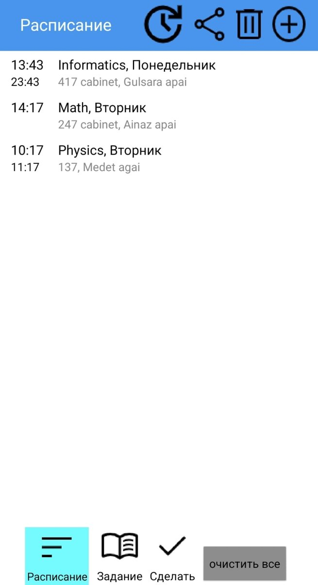
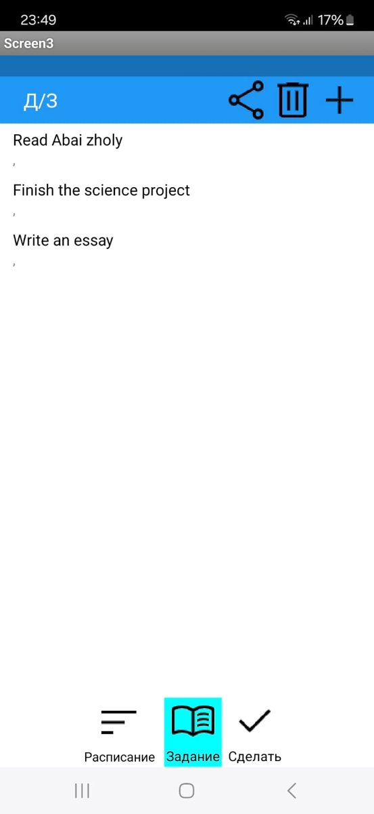
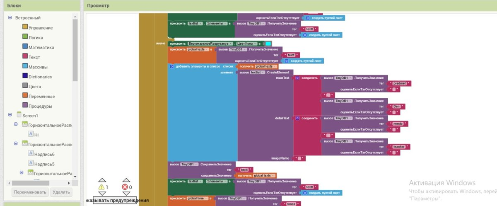
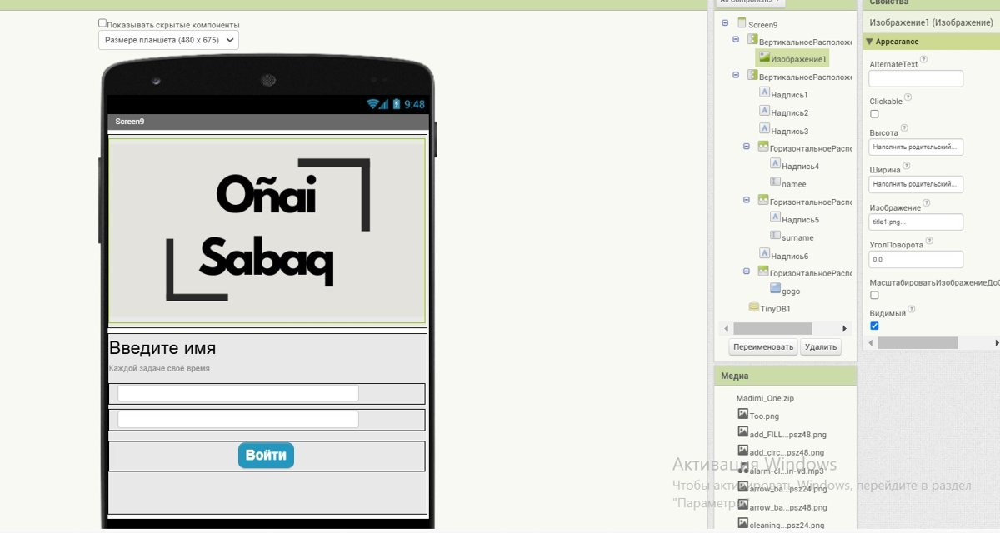

# Oñai sabaq — «Оңай сабақ» 📚

**Easy Lessons**: an all-in-one Android app for students. It keeps your timetable, homework, Pomodoro timer and notes in one place.

Built **solo** in **MIT App Inventor** (block-based programming), with no AI tools. I learned App Inventor myself from tutorials, books and YouTube.

🥇 **1st place — Astana JasSkills 2024** (school WorldSkills championship, mobile app development)
🌏 Presented at **INFOMATRIX ASIA-2025**
🗓 2024–2025, 10th grade, Specialized Lyceum No. 9 "Zerde", Astana

  
  &nbsp;
  

## 📲 Download

**[⬇ Download the APK for Android](../../releases/latest)**

## Why

Students juggle lots of subjects, homework and deadlines. Kundelik tracks grades but doesn't help you organise your day. Google Calendar has no study tools. Notion is too complex for many students, and Pomodoro apps only do timers. I wanted one simple app that has everything a student needs.

## Features

- 🗓 **Timetable:** add, edit, delete and **share** your lesson schedule
- ⏱ **Pomodoro timer** with adjustable intervals
- ✅ **Homework tracker:** add, edit, delete tasks
- ✏️ **Notes:** write and **draw** on a canvas
- 👤 **Registration** with Google Firebase, so the app is personal

## How it's built

| Part | Tech |
|---|---|
| App logic | MIT App Inventor blocks: several screens connected with code blocks |
| Local storage | TinyDB (data saved in the phone's memory) |
| User accounts | Google Firebase |
| Design | Logo, icons and layout made in Canva |

  
  

## Testing

Classmates and teachers used the app for a week. From their feedback I fixed unclear icons, added a customizable timer, and added drawing notes and timetable sharing.

## What was hard

The coding was full of errors. Connecting many screens and keeping data in sync between TinyDB and Firebase took a lot of debugging with the help of tutorials and the MIT App Inventor community forum.

## Author

**Adilet Bakytzhanuly** ([@Adikich](https://github.com/Adikich)): idea, design, development, testing

Supervisor: Gulsara Zhumagatova, computer science teacher, Specialized Lyceum No. 9 "Zerde"
